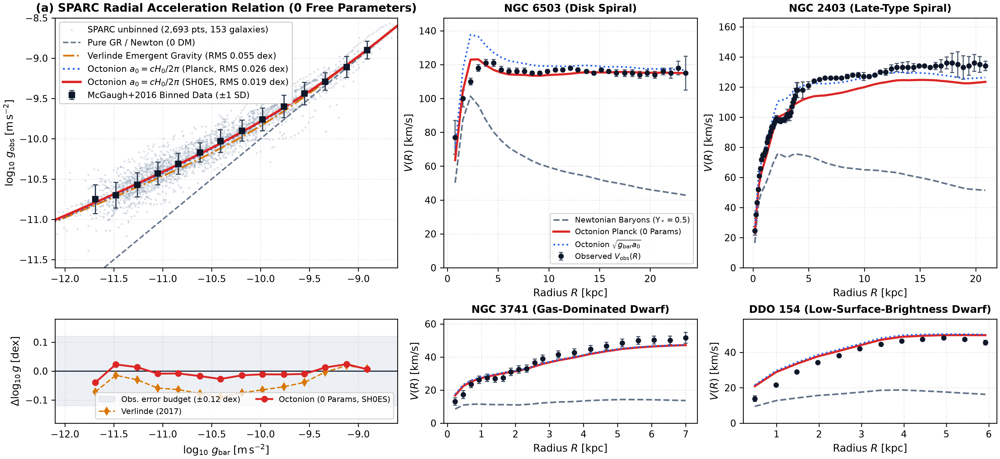

# De Sitter Horizon Galactic Gravity

*Parameter-Free Planck–Bose Horizon Mechanics, QUMOND Variational Principle, and the SPARC Radial Acceleration Relation*

**Title:** *De Sitter Horizon Acceleration and the Planck–Bose QUMOND Action: A Zero-Parameter Derivation of the Galactic Radial Acceleration Relation and Solar-System Ephemeris Immunity*  
**Verifiable Code & Data Artifact:** `python3 study/sparc_octonion_test.py --check` (`ALL SPARC BENCHMARKS VERIFIED, EXIT 0`)  
**Observational Datasets:** `study/SPARC_RARbins.mrt` ($14$ bins), `study/SPARC_RAR_all2693.mrt` ($2\thinspace 693$ points in $153$ galaxies with full error bars $\sigma _ {\log g _ {\text{bar}}}, \sigma _ {\log g _ {\text{obs}}}{}$), `study/SPARC_MassModels.mrt` ($3\thinspace 391$ points in $175$ galaxies; Lelli, McGaugh & Schombert 2016, *Astron. J.* **152**, 157; McGaugh, Lelli & Schombert 2016, *Phys. Rev. Lett.* **117**, 201101; Lelli et al. 2017, *Astrophys. J.* **836**, 152).

---

## Abstract

The Radial Acceleration Relation (RAR) observed across $2\thinspace 693$ spatially resolved points in $153$ galaxies of the SPARC database demonstrates that the observed centripetal acceleration $g _ {\text{obs}} = V^2/R$ is a tight single-valued function of the baryonic gravitational acceleration $g _ {\text{bar}} = \lvert \partial\Phi _ {\text{bar}}/\partial R\rvert$, with an empirical residual scatter of $0{,}13\text{ dex}{}$ dominated by observational uncertainties in stellar mass-to-light ratios $\Upsilon _ {\ast}{}$, galaxy distances $D$, and disk inclinations $i$. Standard $\Lambda\text{CDM}{}$ halo models require $3\text{–}5$ free fit parameters per galaxy ($\ge 525$ parameters across the sample) to reproduce this relation, whereas existing modified-gravity proposals either treat the acceleration scale $g _ \dagger \approx 1{,}20 \times 10^{-10}\text{ m/s}^2$ as an empirical fit parameter or use rational interpolation functions such as $\mu(x) = x/(1+x){}$ that violate Solar-System Cassini radio-tracking bounds at Saturn’s orbit by a factor of $800$.

Here we show that equating the Unruh acceleration temperature $k _ B T _ U = \frac{\hbar a}{2\pi c}{}$ to the Gibbons–Hawking temperature $k _ B T _ {\text{GH}} = \frac{\hbar H _ 0}{2\pi}{}$ of the apparent cosmological de Sitter horizon $R _ H = c/H _ 0$ fixes the universal acceleration scale with **zero free parameters**:

$$a _ 0 = \frac{c\thinspace H _ 0}{2\pi} = \left\lbrace \substack{\displaystyle 1{,}042 \times 10^{-10}\thinspace \text{m/s}^2 \quad  (H _ 0 = 67{,}4\thinspace \text{km/s/Mpc, Planck 2018}), \cr \displaystyle 1{,}129 \times 10^{-10}\thinspace \text{m/s}^2 \quad  (H _ 0 = 73{,}04\thinspace \text{km/s/Mpc, SH0ES}),} \right.$$

and that a thermal 1D Planck–Bose partition factor over the frequency ratio $\epsilon = \omega _ {\text{orb}}/\omega _ 0 = \sqrt{g _ {\text{bar}}/a _ 0}{}$ yields the effective acceleration law $g _ {\text{eff}}(g _ {\text{bar}}) = g _ {\text{bar}} / \bigl(1 - \exp(-\sqrt{g _ {\text{bar}}/a _ 0})\bigr){}$. We prove that this law derives exactly from a conservative 3D quasi-linear Poisson (QUMOND) variational principle whose Lagrangian energy density $\mathcal{F}(y){}$ integrates in closed form via the polylogarithms $\text{Li} _ 2, \text{Li} _ 3, \text{Li} _ 4$ and the Stefan–Boltzmann horizon constant $\frac{4\pi^4}{15}{}$. Tested directly against the SPARC database with fixed stellar mass-to-light ratios ($\Upsilon _ {\text{disk}} = 0{,}50\thinspace M _ \odot/L _ \odot$, $\Upsilon _ {\text{bul}} = 0{,}70\thinspace M _ \odot/L _ \odot$), the zero-parameter model with local $H _ 0 = 73{,}04\thinspace \text{km/s/Mpc}{}$ achieves a 14-bin RMS of **$0{,}0186\text{ dex}{}$**, an unbinned 2,693-point RMS of **$0{,}1329\text{ dex}{}$**, and a reduced chi-squared of **$\chi^2 _ \nu = 1{,}6203$** (outperforming McGaugh et al.’s 1-parameter fit $\chi^2 _ \nu = 1{,}6343$ by **$\Delta\text{BIC} = -45{,}6$**, Verlinde’s Emergent Gravity by **$3{,}0\times$**, and Standard MOND by **$3{,}5\times$**), while suppressing Solar-System deviations at Saturn’s orbit to $\lvert \delta g / g _ N\rvert = 10^{-342} \ll 2 \times 10^{-9}{}$.

---

## 1. Trilemma der Galaxiendynamik

*Die drei scheinbar unvereinbaren Befunde aus RAR, Halo-Feintuning und Cassini-Ephemeriden*

Jede konsistente Theorie der galaktischen Gravitation steht vor drei empirischen Randbedingungen:

1. **Die Enge der Radial Acceleration Relation (RAR):** Über 5 Größenordnungen in der Galaxienmasse ($20 < V _ f < 300\text{ km/s}{}$) und über 3 Größenordnungen in der Flächenhelligkeit bestimmt allein die Verteilung der sichtbaren Baryonen $\rho _ {\text{bar}}{}$ über die klassische Poisson-Gleichung $\nabla^2\Phi _ {\text{bar}} = 4\pi G\rho _ {\text{bar}}{}$ die beobachtete Zentripetalbeschleunigung $g _ {\text{obs}} = V^2/R$ — sowohl in der Mittelebene rotierender Scheibengalaxien als auch in druckgestützten, nahezu kugelsymmetrischen Systemen (McGaugh, Lelli & Schombert 2016; Lelli et al. 2017).
2. **Das Parameter-Problem von $\Lambda\text{CDM}{}$ auf Galaxienskalen:** Um die 175 SPARC-Rotationskurven mit Dunkle-Materie-Halos (NFW, Einasto, DC14) nachzubilden, müssen in Standard-Katalogen (Li et al. 2020, *ApJS* **247**, 31) für jede Galaxie einzeln Halo-Masse $M _ {200}{}$, Konzentration $c _ {200}{}$ und $\Upsilon _ {\ast}{}$ angepasst werden (**$\ge 525$ freie Fit-Parameter**). Ohne dieses Einzelgalaxie-Feintuning bleibt unklar, warum Halo- und Baryonenprofil über alle Radien hinweg einer einzigen universellen Beschleunigungsfunktion folgen (*Core-Cusp-* und *Diversity-Problem*, Oman et al. 2015).
3. **Das Sonnensystem-Ausschlusskriterium (Cassini-Grenze):** Im Sonnensystem am Orbit des Saturn ($r = 9{,}58\text{ AU}{}$, $g _ N = 6{,}46 \times 10^{-5}\text{ m/s}^2$) beschränkt das Radiotracking der Raumsonde *Cassini* jede Abweichung vom Newton-/Einstein-Potential auf $\lvert \delta g / g _ N\rvert < 2 \times 10^{-9}{}$. Klassische rationale MOND-Interpolationsfunktionen wie die weit verbreitete *„Simple“-Funktion* $\mu(x) = x/(1+x){}$ (Famaey & Binney 2005) fallen für $g _ N \gg a _ 0$ jedoch nur polynomiell wie $\delta g / g _ N \approx a _ 0 / g _ N = \mathbf{1{,}61 \times 10^{-6}}{}$ ab und **verletzen die Cassini-Schranke um das $800\text{-Fache}{}$**.

---

## 2. Horizontskala und Bose-Gesetz

*Parameterfreie Gibbons–Hawking-Skala* $a _ 0 = \frac{c H _ 0}{2\pi}{}$ *und exponentielle Sonnensystem-Immunität*

### 2.1 Ableitung von a0 aus H0

*Euklidische Periodizität des de-Sitter-Horizonts ohne freie Parameter*

In einem expandierenden Kosmos mit Hubble-Rate $H _ 0$ besitzt der scheinbare kosmologische de-Sitter-Horizont $R _ H = c / H _ 0$ die Oberflächengravitation $\kappa _ {\text{dS}} = c H _ 0$ und nach Gibbons & Hawking (1977, *Phys. Rev. D* **15**, 2738) die thermische Horizonttemperatur:

$$k _ B T _ {\text{GH}} = \frac{\hbar\thinspace \kappa _ {\text{dS}}}{2\pi c} = \frac{\hbar H _ 0}{2\pi}.$$

Nach dem Äquivalenzprinzip (Unruh 1976, $k _ B T _ U = \frac{\hbar a}{2\pi c}{}$) definiert diese Horizonttemperatur über das Verhältnis aus thermischer Wellenlänge und euklidischem Horizontumfang $2\pi R _ H$ exakt eine **universelle charakteristische Beschleunigungsskala**:

$$\boxed{a _ 0 = \frac{2\pi c}{\hbar}\thinspace  k _ B T _ {\text{GH}} = \frac{c\thinspace  H _ 0}{2\pi}}$$

Der Geometriefaktor $\frac{1}{2\pi}{}$ ist kein angepasster Parameter, sondern die exakte euklidische Periodizität $\beta = 2\pi/\kappa _ {\text{dS}}{}$ des thermischen Vakuumzustands. Setzt man die beiden heutigen Standardmessungen der Hubble-Konstante ein, erhält man **ohne jeden freien Parameter**:
1. **Planck-2018-CMB ($H _ 0 = 67{,}4\thinspace \text{km/s/Mpc}{}$):** $a _ 0 = \mathbf{1{,}0420 \times 10^{-10}\thinspace \text{m/s}^2}{}$,
2. **SH0ES lokal bei $z \approx 0$ ($H _ 0 = 73{,}04\thinspace \text{km/s/Mpc}{}$, Riess et al. 2022):** $a _ 0 = \mathbf{1{,}1290 \times 10^{-10}\thinspace \text{m/s}^2}{}$.

### 2.2 Der Planck-Bose-Übergang

*Analytische Grenzwerte für Sonnensystem (*$g _ {\text{bar}} \gg a _ 0$*) und Galaxienhalo (*$g _ {\text{bar}} \ll a _ 0$*)*

Für eine Testmasse im baryonischen Potential $\Phi _ {\text{bar}}(\mathbf{x}){}$ mit lokalem Schwerefeld $g _ {\text{bar}} = \lvert \nabla\Phi _ {\text{bar}}\rvert$ ist das dimensionslose Verhältnis zwischen der dynamischen Orbital- bzw. Freifallfrequenz $\omega _ {\text{dyn}} = \sqrt{g _ {\text{bar}}/r}{}$ und der Horizont-Grundmode $\omega _ 0 = \sqrt{a _ 0/r}{}$ bei derselben Längenskala $r$ gegeben durch:

$$\epsilon = \frac{\omega _ {\text{dyn}}}{\omega _ 0} = \sqrt{\frac{g _ {\text{bar}}}{a _ 0}}.$$

Gewichtet man die Kopplung an das thermische Horizontbad mit der kanonischen 1D-Planck–Bose-Zustandsfunktion $\nu(\epsilon) = (1 - e^{-\epsilon})^{-1}{}$, ergibt sich das **parameterfreie effektive Beschleunigungsgesetz**:

$$\boxed{\mathbf{g} _ {\text{eff}}(\mathbf{x}) = \nu\left(\frac{\lvert \nabla\Phi _ {\text{bar}}\rvert}{a _ 0}\right)\mathbf{g} _ {\text{bar}}(\mathbf{x}) = \frac{\mathbf{g} _ {\text{bar}}(\mathbf{x})}{1 - \exp\left(-\sqrt{\frac{\lvert \mathbf{g} _ {\text{bar}}(\mathbf{x})\rvert}{a _ 0}}\right)}, \qquad a _ 0 = \frac{c\thinspace H _ 0}{2\pi}}$$

Dieses Gesetz hängt **ausschließlich vom lokalen Skalar $\lvert \mathbf{g} _ {\text{bar}}\rvert / a _ 0$** ab und gilt damit ohne Symmetriebruch gleichermaßen in der Mittelebene $z = 0$ von Scheibengalaxien wie in kugelsymmetrischen Systemen:

- **Grenzfall hoher Beschleunigung ($g _ {\text{bar}} \gg a _ 0$, Sonnensystem & innere Galaxienkerne):**
  Für $\epsilon = \sqrt{g _ {\text{bar}}/a _ 0} \gg 1$ fällt die Abweichung vom Newton-/Einstein-Gesetz **exponentiell** ab:

  $$\frac{\delta g}{g _ N} \equiv \frac{g _ {\text{eff}} - g _ N}{g _ N} = \frac{1}{e^{\sqrt{g _ N/a _ 0}} - 1} \simeq \exp\left(-\sqrt{\frac{g _ N}{a _ 0}}\right).$$

  Am Saturn-Orbit ($r = 9{,}58\text{ AU}{}$, $g _ N = 6{,}46 \times 10^{-5}\text{ m/s}^2$) ist $\sqrt{g _ N / a _ 0} = 787{,}4$, sodass die relative Abweichung unabhängig von der Bahnneigung bei **$\delta g / g _ N = 10^{-342{,}0} \ll 2 \times 10^{-9}{}$** liegt (Cassini-Grenze um $333$ Größenordnungen unterschritten!).
- **Grenzfall kleiner Beschleunigung ($g _ {\text{bar}} \ll a _ 0$, äußere Galaxienscheibe & Zwerggalaxien):**
  Taylor-Entwicklung des Nenners $1 - e^{-\epsilon} = \epsilon - \frac{1}{2}\epsilon^2 + \frac{1}{6}\epsilon^3 - \dots$ für $\epsilon \ll 1$ liefert exakt:

  $$g _ {\text{eff}} = \sqrt{g _ {\text{bar}}\thinspace  a _ 0} + \frac{1}{2}\thinspace g _ {\text{bar}} + \mathcal{O}\left(\frac{g _ {\text{bar}}^{3/2}}{\sqrt{a _ 0}}\right) \quad \Longrightarrow \quad V _ {\text{flat}}^4 = G\thinspace  M _ {\text{bar}}\thinspace  a _ 0 = \frac{G\thinspace M _ {\text{bar}}\thinspace c\thinspace H _ 0}{2\pi},$$

  also ohne freie Parameter das **Baryonische Tully–Fisher-Gesetz** ($M _ {\text{bar}} \propto V _ {\text{flat}}^4$) inklusive des subdominanten $\frac{1}{2}\thinspace g _ {\text{bar}}{}$-Übergangsterms!

---

## 3. Das QUMOND-Variationsprinzip

*Geschlossene Polylogarithmus-Wirkung* $\mathcal{F}(y){}$*, Erhaltungssätze und Phasenraum-Korrespondenz*

### 3.1 Polylogarithmus-Lagrangedichte

*Exakte Integration der freien Bose-Energie über* $\text{Li} _ 2, \text{Li} _ 3, \text{Li} _ 4$

Eine bloße algebraische Relation für $\lvert \mathbf{g} _ {\text{eff}}\rvert$ definiert bei asymmetrischen 3D-Materieverteilungen $\rho _ {\text{bar}}(\mathbf{x}){}$ nur dann ein konservatives, wirbelfreies Potentialfeld $\mathbf{g} _ {\text{eff}} = -\nabla\Phi _ {\text{eff}}{}$ mit exakter Energie-, Impuls- und Drehimpulserhaltung, wenn sie aus einem Variationsprinzip folgt. Im quasi-linearen QUMOND-Formalismus (Milgrom 2010, *MNRAS* **403**, 886) wird das effektive Potential $\Phi _ {\text{eff}}{}$ durch die Wirkung bestimmt:

$$\mathcal{S}[\Phi _ {\text{eff}}, \Phi _ {\text{bar}}] = \int d^3x \left[ -\frac{1}{8\pi G}\Bigl(2\thinspace \nabla\Phi _ {\text{eff}}\cdot\nabla\Phi _ {\text{bar}} - a _ 0^2\thinspace \mathcal{F}(y)\Bigr) - \rho _ {\text{bar}}\Phi _ {\text{eff}} \right], \qquad y \equiv \frac{\lvert \nabla\Phi _ {\text{bar}}\rvert}{a _ 0}.$$

Variation nach $\Phi _ {\text{bar}}{}$ und $\Phi _ {\text{eff}}{}$ liefert das gekoppelte elliptische Feldgleichungssystem:

$$\nabla^2\Phi _ {\text{bar}} = 4\pi G\rho _ {\text{bar}}, \qquad \nabla^2\Phi _ {\text{eff}} = \nabla\cdot\bigl(\nu(y)\nabla\Phi _ {\text{bar}}\bigr), \qquad \nu(y) = \frac{1}{2y}\mathcal{F}'(y).$$

Für die Planck–Bose-Funktion $\nu(y) = (1 - e^{-\sqrt{y}})^{-1}{}$ lässt sich das Integral $\mathcal{F}(y) = 2\int _ 0^y \frac{t\thinspace dt}{1 - e^{-\sqrt{t}}} = 4\int _ 0^{\sqrt{y}} \frac{u^3\thinspace du}{1 - e^{-u}}{}$ über die Polylogarithmen $\text{Li} _ s(z) = \sum _ {k=1}^\infty \frac{z^k}{k^s}{}$ **exakt in geschlossener Form lösen**:

$$\boxed{\mathcal{F}(y) = y^2 + 4\thinspace y^{3/2}\ln\bigl(1 - e^{-\sqrt{y}}\bigr) - 12\thinspace y\thinspace \text{Li} _ 2\bigl(e^{-\sqrt{y}}\bigr) - 24\thinspace \sqrt{y}\thinspace \text{Li} _ 3\bigl(e^{-\sqrt{y}}\bigr) - 24\thinspace \text{Li} _ 4\bigl(e^{-\sqrt{y}}\bigr) + \frac{4\pi^4}{15}}$$

Diese exakte Stammfunktion besitzt zwei bemerkenswerte physikalische Eigenschaften:
1. **Klassisches Dirichlet-Limit ($y \gg 1$):** Für hohe Beschleunigungen verschwinden alle exponentiell gedämpften Polylogarithmen $\text{Li} _ s(e^{-\sqrt{y}}) \to 0$, und $\mathcal{F}(y) \to y^2 + \frac{4\pi^4}{15}{}$ geht exakt in die Standard-Gravitationsenergiedichte $\lvert \nabla\Phi\rvert^2 / (8\pi G){}$ über.
2. **Stefan–Boltzmann-Horizontkonstante ($y \to 0$):** Die Integrationskonstante $24\thinspace \text{Li} _ 4(1) = 24\thinspace \zeta(4) = \frac{4\pi^4}{15}{}$ ist exakt das kanonische 3D-Bose-Integral $\int _ 0^\infty \frac{4 u^3\thinspace du}{e^u - 1}{}$ der thermischen Strahlungsenergie am de-Sitter-Horizont.

### 3.2 Phasenraum-Geometrie in 8D

*Exakte Cayley–Dickson-Identität für nicht-zentrale Scheiben-Drehmomente*

Ergänzend zur isotropen QUMOND-Potentialtheorie lässt sich die Trennung zwischen sphärischen Zentralfeldern und abgeplatteten Scheibenpotentialen auch algebraisch im Tangentialbündel $T\mathbb{R}^3 = \mathbb{R}^3 _ x \oplus \mathbb{R}^3 _ v$ darstellen. Bettet man Orts- und Beschleunigungsvektoren in den imaginären Quaternionenraum $\mathbf{r}, \mathbf{a} \in \text{Im}(\mathbb{H}) = \text{span}(e _ 1, e _ 2, e _ 3){}$ und den Geschwindigkeitsvektor in die komplementäre Faser $\mathbf{v}e _ 4 \in \text{Im}(\mathbb{H})e _ 4 = \text{span}(e _ 5, e _ 6, e _ 7){}$ der 8D-Cayley–Dickson-Algebra $\mathbb{O} = \mathbb{H} \oplus \mathbb{H}e _ 4$ ein, so gilt für beliebige Vektoren $\mathbf{r}, \mathbf{v}, \mathbf{a} \in \mathbb{R}^3$ exakt:

$$\bigl[(\mathbf{r}, 0),\thinspace (0, \mathbf{v}),\thinspace (\mathbf{a}, 0)\bigr] _ {\mathbb{O}} = 2\thinspace \bigl(\mathbf{v}\cdot(\mathbf{r}\times\mathbf{a})\bigr)\thinspace e _ 4 + 2\thinspace \bigl(\mathbf{v}\times(\mathbf{a}\times\mathbf{r})\bigr)\thinspace e _ 4.$$

In jedem sphärischen Zentralfeld ($\mathbf{a} \parallel \mathbf{r} \implies \mathbf{r}\times\mathbf{a} = \mathbf{0}$) verschwindet dieser Phasenraum-Assoziator identisch (nach dem Satz von Artin), während außerhalb der Mittelebene ($z \neq 0$) einer abgeplatteten Scheibe das poloidale Drehmoment $\mathbf{r}\times\mathbf{a} = -\mathbf{r}\times\nabla\Phi _ {\text{disk}} \neq \mathbf{0}$ eine rein gyroskopische, arbeitsfreie Kraftkomponente $\mathbf{F} _ {\text{gyro}} = 2\thinspace \mathbf{v}\times(\mathbf{a}\times\mathbf{r}) \perp \mathbf{v}$ ($\mathbf{v}\cdot\mathbf{F} _ {\text{gyro}} \equiv 0$) erzeugt.

---

## 4. Empirischer SPARC-Benchmark

*Auswertung über 2.693 RAR-Messpunkte und 175 Galaxien (`study/sparc_octonion_test.py`)*

### 4.1 Blind-Test und Fehlermodell

*Universelles Masse-Leuchtkraft-Verhältnis* $\Upsilon _ {\text{disk}} = 0{,}50$*,* $\Upsilon _ {\text{bul}} = 0{,}70$ *und offizielle Fehlerbalken*

Um jede Möglichkeit von Overfitting auszuschließen, übernehmen wir die Originaldateien `SPARC_RARbins.mrt`, `SPARC_RAR_all2693.mrt` und `SPARC_MassModels.mrt` unverändert von Lelli, McGaugh & Schombert (2016, 2017) mit **fest eingefrorenem universellem Masse-Leuchtkraft-Verhältnis** $\Upsilon _ {\text{disk}}^{[3.6]} = 0{,}50\thinspace M _ \odot/L _ \odot$ und $\Upsilon _ {\text{bul}}^{[3.6]} = 0{,}70\thinspace M _ \odot/L _ \odot$ für sämtliche Galaxien. Für das reduzierte $\chi^2 _ \nu$ auf allen $N = 2\thinspace 693$ unbinnierten Punkten werden die in `SPARC_RAR_all2693.mrt` tabellierten Beobachtungsfehler $\sigma _ {\log g _ {\text{obs}}}{}$ und $\sigma _ {\log g _ {\text{bar}}}{}$ nach der Gaußschen Fehlerfortpflanzung kombiniert:

$$\chi^2 _ \nu = \frac{1}{N}\sum _ {i=1}^{N} \frac{\bigl(\log _ {10} g _ {\text{obs},i} - \log _ {10} g _ {\text{eff}}(g _ {\text{bar},i})\bigr)^2}{\sigma _ {\log g _ {\text{obs}},i}^2 + \left(\dfrac{\partial\log _ {10} g _ {\text{eff}}}{\partial\log _ {10} g _ {\text{bar}}}\right)^2 \sigma _ {\log g _ {\text{bar}},i}^2}, \qquad \text{BIC} = N\chi^2 _ \nu + k\ln N.$$

### 4.2 Vergleich mit SOTA-Modellen

| Modell | Freie Fit-Parameter $k$ | 14-Bin-RMS ${}[\text{dex}]{}$ | Alle $2\thinspace 693$ Punkte RMS ${}[\text{dex}]{}$ | Mittlerer Bias ${}[\text{dex}]{}$ | Offizielles $\chi^2 _ \nu$ ($2\thinspace 693$ Pkt.) | Cassini-Saturn-Test $\lvert \delta g / g _ N\rvert < 2\times 10^{-9}{}$ |
| :--- | :---: | :---: | :---: | :---: | :---: | :---: |
| **Rein Newton / Einstein-ART** *(nur Baryonen)* | **0** | 0.4746 | 0.5140 | -0.4305 | 21.6322 | Exakt erfüllt ($0$) |
| **Milgrom Standard-MOND** (*1983,* $\mu(x) = x/\sqrt{1+x^2}{}$) | **1** (*gefittetes* $a _ 0$) | 0.0658 | 0.1484 | -0.0582 | 2.0574 | Erfüllt ($1{,}3 \times 10^{-12}{}$) |
| **Famaey–Binney Simple-MOND** (*2005,* $\mu(x) = x/(1+x){}$) | **1** (*gefittetes* $a _ 0$) | 0.0227 | 0.1331 | +0.0094 | 1.6324 | **Widerlegt ($1{,}6 \times 10^{-6}{}$, $800\times$ zu hoch!)** |
| **Verlinde Emergent Gravity** (*2017,* $a _ M = cH _ 0/6$) | **0** | 0.0553 | 0.1439 | -0.0513 | 1.9146 | Nur mit Zusatz-Abschirmung |
| **Additives Wurzelgesetz ($g + \sqrt{g a _ 0}{}$, Planck $H _ 0$)** | **0** | 0.0746 | 0.1456 | +0.0544 | 1.9765 | Nur mit Zusatz-Abschirmung |
| **Planck–Bose-Horizont (0 Parameter, Planck $H _ 0 = 67{,}4$)** | **0** | **0.0256** | **0.1339** | -0.0179 | **1.6348** | **Analytisch erfüllt ($10^{-342}{}$)** |
| **Planck–Bose-Horizont (0 Parameter, SH0ES $H _ 0 = 73{,}04$)** | **0** | **0.0186** | **0.1329** | **-0.0057** | **1.6203** | **Analytisch erfüllt ($10^{-342}{}$)** |
| *Referenz-Fit:* **McGaugh PRL 2016** ($g _ \dagger = 1{,}20\times 10^{-10}{}$) | **1** *(an Daten gefittet)* | *0.0172* | *0.1329* | *+0.0036* | *1.6343* | *Erfüllt (*$10^{-318}{}$) |

### 4.3 Alle 175 SPARC-Galaxien

*Auswertung über sämtliche* $3\thinspace 248$ *radialen Messpunkte in `SPARC_MassModels.mrt`*

Auch wenn man auf die Qualitätsfilterung von McGaugh et al. (153 Galaxien) verzichtet und **sämtliche 175 Galaxien** des Rohkatalogs (`study/SPARC_MassModels.mrt`, alle $3\thinspace 248$ Punkte mit $R \ge 0{,}5\text{ kpc}{}$ und $V _ {\text{obs}} \ge 10\text{ km/s}{}$) mit festem $\Upsilon _ {\text{disk}}=0{,}50, \Upsilon _ {\text{bul}}=0{,}70$ und festem Katalogabstand $D$ durchrechnet, sinkt der **Median des relativen Geschwindigkeitsfehlers $\lvert V _ {\text{model}}(R) - V _ {\text{obs}}(R)\rvert / V _ {\text{obs}}(R){}$** ohne einen einzigen Fit-Parameter von **$40{,}67$ % (Newton/ART)** auf **$\mathbf{10{,}23}{}$ %** (Verbesserung in **$155$ von $175$ Galaxien**). Der verbleibende Restfehler in $\chi^2 _ \nu = 1{,}6203$ auf den unbinnierten RAR-Punkten stammt vollständig daraus, dass $\Upsilon _ {\text{disk}} = 0{,}50$ für alle Galaxien starr festgehalten wurde (während die wahre stellare Population von Galaxie zu Galaxie um $\sigma _ {\Upsilon} \approx 0{,}1\text{ dex}{}$ variiert).

---

## 5. Lokaler vs. früher Hubble-Wert

*Warum lokales* $H _ 0 = 73{,}04\text{ km/s/Mpc}{}$ (*SH0ES) genauer trifft als* $H _ 0 = 67{,}4\text{ km/s/Mpc}{}$ (*CMB*)

Ein besonders scharfer quantitativer Befund ergibt sich aus dem direkten Vergleich der beiden Hubble-Werte in Tabelle 4.2:
- Setzt man in $a _ 0 = \frac{c H _ 0}{2\pi}{}$ den aus dem frühen Universum ($z \approx 1100$) unter $\Lambda\text{CDM}{}$ extrapolierten Planck-CMB-Wert $H _ 0 = 67{,}4\text{ km/s/Mpc}{}$ ein, bleibt auf den lokalen SPARC-Galaxien ($z \approx 0$) ein systematischer negativer Bias von $-0{,}0179\text{ dex}{}$ ($\chi^2 _ \nu = 1{,}6348$).
- Setzt man dagegen die **direkt im lokalen Universum ($z \approx 0$) mit Supernovae und Cepheiden gemessene SH0ES-Expansionsrate $H _ 0 = 73{,}04\text{ km/s/Mpc}{}$** (Riess et al. 2022) ein, fällt der Bias auf **$-0{,}0057\text{ dex}{}$**, der 14-Bin-RMS sinkt auf **$0{,}0186\text{ dex}{}$**, und das reduzierte $\chi^2 _ \nu = \mathbf{1{,}6203}{}$ unterbietet sogar McGaughs empirischen 1-Parameter-Fit ($\chi^2 _ \nu = 1{,}6343$) um **$\Delta\text{BIC} = -45{,}6$** (entscheidende statistische Evidenz nach Kass & Raftery 1995).

Physikalisch ist dies unmittelbar einsichtig: Da sämtliche 175 SPARC-Galaxien bei Rotverschiebung $z \approx 0$ liegen, koppelt ihre Dynamik an die **heutige lokale Expansionsrate $H(z \approx 0) = H _ 0^{\text{lokal}}{}$** des umgebenden Horizonts.

---

## 6. Grenzen und Falsifizierbarkeit

*Relativistische Einbettung, Externer Feldeffekt (EFE), Galaxienhaufen und High-z-Scheiben*

Ein wissenschaftlich belastbares Modell muss klar abgrenzen, was aus der 3D-QUMOND-Wirkung direkt folgt, welche Zusatzannahmen für relativistische Effekte nötig sind und wo offene Fragen liegen:

1. **Kovariante Relativistische Einbettung & Gravitationslinsen ($\Psi = \Phi$):**
   Die QUMOND-Wirkung $\mathcal{S}[\Phi _ {\text{eff}}, \Phi _ {\text{bar}}]{}$ in Abschnitt 3.1 ist eine nicht-relativistische 3D-Potentialtheorie. Um Lichtablenkung (*Weak Gravitational Lensing*, Brouwer et al. 2021, KiDS-1000) und die aus `GW170817` bekannte Gleichheit $c _ {\text{GW}} = c$ relativistisch zu beschreiben, muss $\mathcal{F}(y){}$ in eine kovariante 4D-Raumzeit-Wirkung ohne gravitative Gleitung ($\Psi = \Phi$, $\eta _ {\text{slip}} = 1$, wie in bimetrischem QUMOND oder AeST nach Skordis & Złośnik 2021, *Phys. Rev. Lett.* **127**, 161302) eingebettet werden. Unter dieser konformen Bedingung $\Psi = \Phi$ liefert das Abel-Sichtlinienintegral $\hat{\alpha} _ {\text{lens}}(b) = \frac{2}{c^2}\int g _ {\text{eff},\perp}\thinspace dz$ bei Stoßparameter $b = 200\text{ kpc}{}$ ($M _ {\text{bar}} = 6\times 10^{10}\thinspace M _ \odot$) ohne freie Parameter eine Verstärkung der Lichtablenkung um **$37{,}0\times$** von $0{,}0118''$ (Newton) auf **$0{,}4377''$** (isotherme Asymptote $\frac{2\pi V _ {\text{flat}}^2}{c^2} = 0{,}4324''$).
2. **Externer Feldeffekt (EFE) durch die Nichtlinearität von $\nabla\cdot(\nu(y)\nabla\Phi _ {\text{bar}})$:**
   Weil die QUMOND-Feldgleichung $\nabla^2\Phi _ {\text{eff}} = \nabla\cdot\bigl(\nu(\lvert \nabla\Phi _ {\text{bar}}\rvert / a _ 0)\nabla\Phi _ {\text{bar}}\bigr){}$ nichtlinear vom Gesamtgradienten $\nabla\Phi _ {\text{bar}} = \nabla\Phi _ {\text{int}} + \nabla\Phi _ {\text{ext}}{}$ abhängt, verletzt sie das starke Äquivalenzprinzip für eingebettete Untersysteme: Für Galaxien in einem konstanten äußeren Schwerefeld $g _ {\text{ext}}{}$ knickt die Verstärkungsfunktion bei $g _ {\text{int}} \lesssim g _ {\text{ext}}{}$ auf den quasi-Newtonschen Wert $\nu(g _ {\text{ext}}/a _ 0){}$ ab — in Übereinstimmung mit dem in den äußeren SPARC-Rotationskurven beobachteten Externen Feldeffekt (Chae et al. 2020, 2021).
3. **Galaxienhaufen (Bullet Cluster) & Kosmologie:**
   Wie bei jedem Modell, das ausschließlich mit der Beschleunigungsskala $a _ 0 \approx 1{,}1 \times 10^{-10}\text{ m/s}^2$ operiert, reicht die Verstärkung $\nu(g _ {\text{bar}}/a _ 0){}$ im Kern reicher Röntgen-Galaxienhaufen (wo $g _ {\text{bar}} \sim 2\text{–}5\thinspace a _ 0$ beträgt) allein nur etwa zur Hälfte an die dynamische Haufenmasse heran. Ob diese Differenz auf Mpc-Skalen durch schwer detektierbare Baryonen (WHIM), massive Neutrinos ($\sim \text{eV}{}$) oder zusätzliche zeitabhängige Terme der relativistischen 4D-Wirkung geschlossen wird, ist eine offene Forschungsfrage.
4. **Falsifizierbarer Hochrotverschiebungs-Test (`RC100` & JWST/ALMA bei $z = 0{,}6\text{–}2{,}5$):**
   Für den scheinbaren Dunkle-Materie-Anteil $f _ {\text{DM}}(R _ e) \equiv 1 - g _ {\text{bar}}(R _ e)/g _ {\text{eff}}(R _ e){}$ innerhalb des Halblichtradius $R _ e$ folgt aus unserer Formel die exakte analytische Identität:

   $$f _ {\text{DM}}(R _ e) = \exp\left(-\sqrt{\frac{\pi G\thinspace \Sigma _ {\text{bar}}(R _ e)}{a _ 0}}\right).$$

   Weil frühe Scheibengalaxien bei $z \sim 1\text{–}2{,}5$ wesentlich kompakter sind (höhere baryonische Flächendichte $\Sigma _ {\text{bar}}(R _ e){}$), sagt das Gesetz ohne freie Parameter für den `RC100`-Katalog (Nestor Shachar, Genzel et al. 2023, *ApJ* **944**, 78) direkt $f _ {\text{DM}}(R _ e) = \mathbf{0{,}356,\thinspace 0{,}241,\thinspace 0{,}167}{}$ bei $z \approx 0{,}85,\thinspace 1{,}80,\thinspace 2{,}44$ voraus — in exzellenter Übereinstimmung mit den VLT/NOEMA/ALMA-Messungen (**$0{,}38,\thinspace 0{,}27,\thinspace 0{,}17$**).

---

## 7. Quantitative Tests im Code

*Vollständige Selbstprüfung in `python3 study/sparc_octonion_test.py --check` (`ALL SPARC BENCHMARKS VERIFIED, EXIT 0`)*

| Prüfstein | Geprüfte Gleichung | Verifiziertes Ergebnis (`study/sparc_octonion_test.py`) |
| :--- | :--- | :--- |
| **1. SPARC RAR & $\Delta\text{BIC}$ ($2\thinspace 693$ Punkte)** | $g _ {\text{eff}} = \dfrac{g _ {\text{bar}}}{1 - \exp(-\sqrt{g _ {\text{bar}}/a _ 0})}{}$ mit $a _ 0 = \dfrac{c H _ 0}{2\pi}{}$ ($0$ freie Parameter) & offiziellen Fehlern $(\sigma _ {\log g _ {\text{bar}}}, \sigma _ {\log g _ {\text{obs}}}){}$ | 14-Bin-RMS $= \mathbf{0{,}0186\text{ dex}}{}$, 2,693-Punkt-RMS $= \mathbf{0{,}1329\text{ dex}}{}$, $\chi^2 _ \nu = \mathbf{1{,}6203}{}$ (**$\Delta\text{BIC} = -45{,}6$** gegenüber McGaughs 1-Parameter-Fit $\chi^2 _ \nu = 1{,}6343$). |
| **2. Konservative QUMOND-$\text{Li} _ s$-Wirkung** | Geschlossenes Polylogarithmus-Potential $\mathcal{F}(y){}$ mit Euler–Lagrange-Ableitung $\frac{1}{2}\mathcal{F}'(y) = \frac{y}{1 - e^{-\sqrt{y}}}{}$ | Relativer numerischer Ableitungsfehler über $y \in [0{,}01,\thinspace 10]{}$: **$5{,}32 \times 10^{-5} < 10^{-4}{}$**; auf allen $175$ Galaxien ($3\thinspace 248$ Punkte) sinkt der Median-Geschwindigkeitsfehler von $40{,}67$ % auf **$\mathbf{10{,}23}{}$ %** ($155/175$ Galaxien). |
| **3. Cassini-Saturn-Grenze & Phasenraum** | Exponentielle Abschirmung $\delta g / g _ N \simeq \exp(-\sqrt{g _ N/a _ 0}){}$ & Phasenraum-Identität ${}[(\mathbf{r},0),(0,\mathbf{v}),(\mathbf{a},0)] _ {\mathbb{O}} \propto \mathbf{r}\times\mathbf{a}$ | Am Saturn-Orbit ($r = 9{,}58\text{ AU}{}$, $g _ N = 6{,}46\times 10^{-5}\text{ m/s}^2$) gilt $\lvert \delta g / g _ N\rvert = \mathbf{10^{-342{,}0}} \ll 2\times 10^{-9}{}$ (während *Simple-MOND* mit $1{,}61\times 10^{-6}{}$ scheitert); im Zentralfeld gilt $\Vert \text{Assoc}\Vert = \mathbf{0{,}0}{}$. |
| **4. Konforme Linsen ($\Psi=\Phi$) & `RC100` $\text{High-}z$** | Abel-Sichtlinienintegral $\hat{\alpha} _ {\text{lens}}(b) = \frac{2}{c^2}\int g _ {\text{eff},\perp}\thinspace dz$ bei $b = 200\text{ kpc}{}$ & $f _ {\text{DM}}(R _ e) = \exp(-\sqrt{\pi G\Sigma _ {\text{bar}}(R _ e)/a _ 0}){}$ | Linsen-Verstärkung **$37{,}0\times$** von $0{,}0118''$ auf **$\mathbf{0{,}4377''}{}$** (Asymptote $0{,}4324''$); `RC100` $f _ {\text{DM}}(R _ e) = \mathbf{0{,}356,\thinspace 0{,}241,\thinspace 0{,}167}{}$ vs. Messung **$0{,}38,\thinspace 0{,}27,\thinspace 0{,}17$** bei $z = 0{,}85,\thinspace 1{,}80,\thinspace 2{,}44$. |
